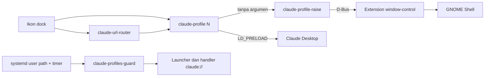

# Blueprint: zorin-claude-desktop-fix

## Ringkasan

Kumpulan skrip kecil untuk Claude Desktop di Zorin OS dan distro GNOME Wayland lain.
Skrip ini memunculkan window Claude saat ikon dock diklik, dan memberi tiap profil ikon dock sendiri.
Targetnya pengguna Linux yang memakai paket resmi `claude-desktop`.

## Status proyek

| Hal | Nilai |
|-----|-------|
| Tahap | Rilis publik pertama |
| URL produksi | Tidak ada. Pengguna memasang lewat `git clone` dan `install.sh`. |
| URL staging | Tidak ada. |
| Repo | `RamaAditya49/zorin-claude-desktop-fix`, publik, lisensi MIT |

## Peta sistem

## Stack

| Lapisan | Teknologi | Catatan |
|---------|-----------|---------|
| Launcher, router, guard, installer | Bash | `set -u`, tanpa dependensi luar |
| Angkat window, generator ikon | Python 3 stdlib | Tanpa paket pip |
| App id per profil | C, `LD_PRELOAD` | Build saat install dengan `gcc` |
| Kontrol window | Extension GNOME `computer-use-linux@avifenesh.dev` versi 3 | Upstream MIT, disalin tanpa perubahan |
| Penjadwal guard | systemd user path dan timer | — |

## Struktur repo

| Path | Isi |
|------|-----|
| `bin/` | `claude-profile`, `claude-profile-raise`, `claude-url-router`, `claude-profiles-guard` |
| `lib/` | `claude-app-id.c`, `make-icons.py` |
| `templates/` | Template launcher, autostart, dan unit systemd |
| `vendor/computer-use-linux@avifenesh.dev/` | Extension GNOME pihak ketiga |
| `install.sh`, `uninstall.sh` | Pasang dan lepas, berbasis manifest |
| `tests/run.sh` | Cek statis dan uji install di HOME sementara |
| `docs/how-it-works.md` | Penjelasan akar masalah untuk pengguna |
| `internal/` | Dokumentasi kerja |

## Lingkungan dan deploy

| Lingkungan | URL | Host | Cara deploy |
|------------|-----|------|-------------|
| Mesin pengguna | — | Desktop pengguna | `./install.sh [--profiles N] [--autostart]` |

## Perintah penting

| Tujuan | Perintah | Jalan di |
|--------|----------|----------|
| Test | `bash tests/run.sh` | Host build terpisah dengan `gcc` dan `python3`, bukan desktop harian maintainer |
| Audit rahasia | `gitleaks detect --source . -v` | Mesin mana saja |
| Install | `./install.sh --profiles 3` | Desktop GNOME Wayland pengguna |
| Uninstall | `./uninstall.sh` | Desktop GNOME Wayland pengguna |

Host build maintainer adalah Fedora KDE tanpa GNOME. Test di sana hanya cek statis dan sandbox, bukan uji live.

## Integrasi luar

| Layanan | Untuk apa | Lokasi kredensial (tanpa nilai) |
|---------|-----------|---------------------------------|
| Tidak ada. | Skrip tidak memakai jaringan. | — |

## Pertanyaan terbuka

- TBD: Apakah uji live di sesi GNOME Wayland bersih (mesin atau VM tanpa setup private) perlu dibuat?

## Sumber fakta

- `internal/spec/20261107-public-release.md`, `internal/plan/20261107-public-release.md`
- Setup private maintainer, versi 2026-11-06
- `cat /etc/os-release` di host build → Fedora Linux 44 (KDE Plasma Desktop Edition), dicek 2026-11-07
