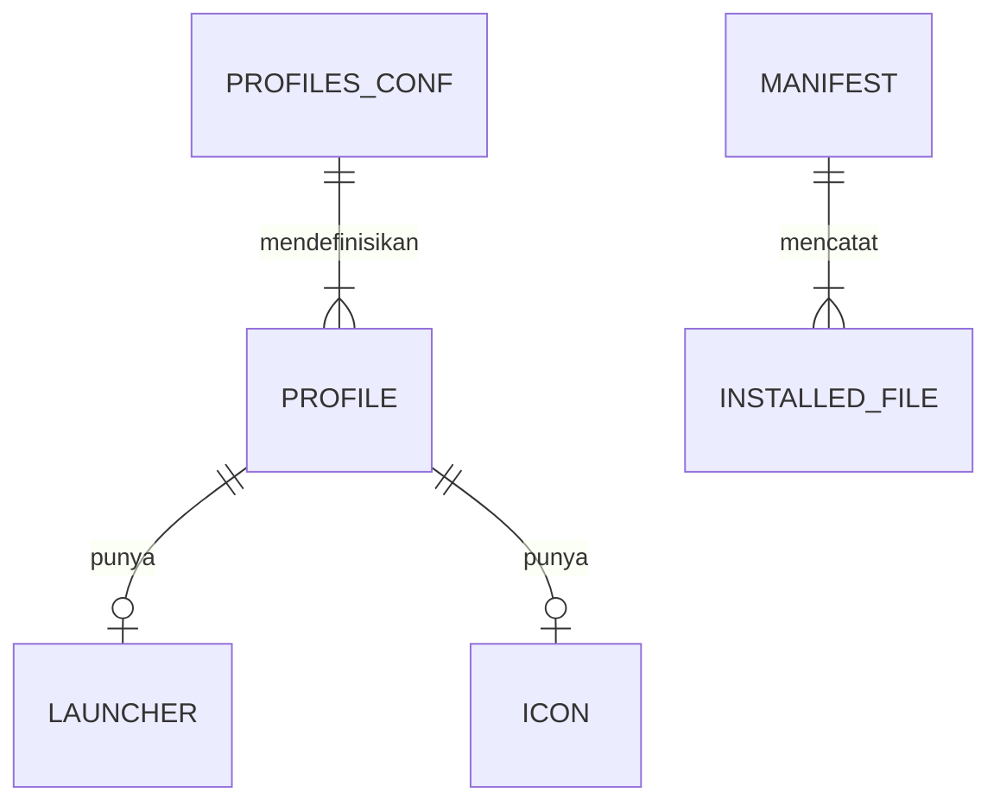

# ERD: zorin-claude-desktop-fix

## Penyimpanan data

Proyek ini tidak memakai database. Semua state berupa berkas teks di HOME pengguna.

| Penyimpanan | Teknologi | Lokasi | Isi |
|-------------|-----------|--------|-----|
| Konfigurasi profil | Teks | `$XDG_CONFIG_HOME/claude-profiles/profiles.conf` | Nomor dan nama tampilan profil |
| Manifest | Teks | `$XDG_DATA_HOME/claude-profiles/manifest` | Path berkas yang dipasang, flag extension |
| Template launcher | `.desktop` | `$XDG_DATA_HOME/claude-profiles/desktop/` | Salinan launcher untuk guard |
| Log | Teks | `$XDG_CACHE_HOME/claude-profiles/*.log` | Kejadian raise, router, guard |
| Data profil | Milik Claude Desktop | `$XDG_CONFIG_HOME/Claude`, `$XDG_CONFIG_HOME/Claude-N` | Login dan data app. Skrip hanya membaca `window-state.json` dan `logs/main.log`. |

## Diagram

## Entitas

### PROFILE (baris di `profiles.conf`)

| Field | Tipe | Wajib | Catatan |
|-------|------|-------|---------|
| `number` | integer 1..9 | ya | Unik. Profil 1 wajib ada. |
| `name` | teks, maks 60 karakter | ya | Nama di dock dan dialog |

### INSTALLED_FILE (baris di `manifest`)

| Field | Tipe | Wajib | Catatan |
|-------|------|-------|---------|
| `path` | path absolut di bawah `$HOME` | ya | Uninstaller menolak path di luar `$HOME` |

## Indeks dan constraint

- Tidak ada.

## Migrasi

- Lokasi migrasi: `Tidak ada.`
- Cara menjalankan: `./install.sh` menulis ulang manifest di tiap run.

## Data pribadi dan retensi

- Log router menyimpan skema dan host link saja, tanpa query string.
- Nama profil adalah teks bebas dari pengguna dan tetap di mesin pengguna.

## Pertanyaan terbuka

- Tidak ada.

## Sumber fakta

- `internal/plan/20261107-public-release.md`, bagian Desain
